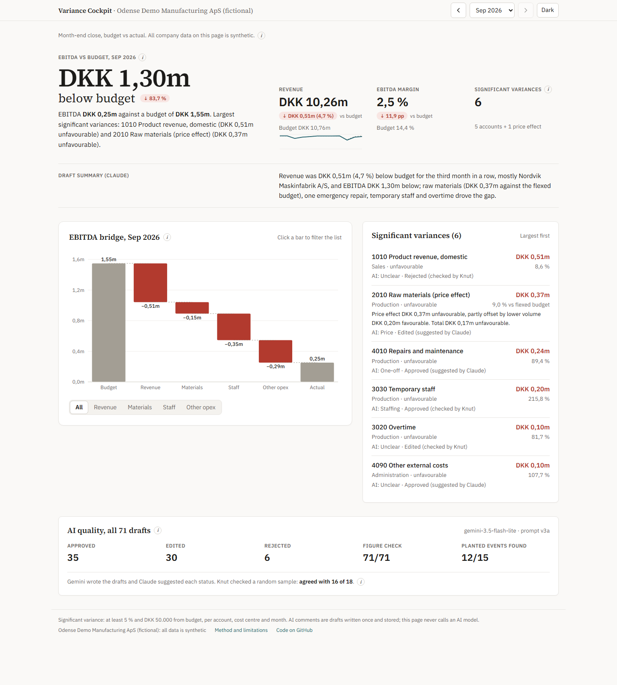

# Variance Cockpit

A month-end close dashboard for budget against actual, where AI drafts a comment on each material variance and the drafts are reviewed.

**Live:** [LIVE_URL] (static site, no login)

> **All data is synthetic.** Odense Demo Manufacturing ApS and all its customers and suppliers are fictional. Any resemblance to real companies is coincidental.



## The problem

At month-end close a controller must explain every large gap between budget and actual. Most of the work is finding the supplier, customer or invoice behind each gap in the ledger. A language model can draft the comments, but only if every number and claim can be checked against the ledger.

## What the dashboard shows

- A KPI row for the chosen month: revenue, EBITDA and EBITDA margin against budget, and the number of material variances. In September 2026 EBITDA was DKK 0,25m against a budget of DKK 1,55m.
- A one-sentence summary of the month, marked "Draft summary (Claude)".
- An EBITDA bridge from budget to actual. Click a bar to filter the list.
- The material variances, largest first: at least 5 % and DKK 50.000 from budget, per account, cost centre and month. Raw materials also get a price row against a budget flexed to actual sales volume.
- A drill-down per variance: the last 12 months, the AI draft, the review status and the ledger lines behind it.
- An AI quality panel with review counts and evaluation scores.

The data covers October 2024 to September 2026, with 71 material variances.

## How it is built

- **Data.** A Python script generates the budget and a general ledger of 2.120 lines from `config/settings.yaml`, with a fixed random seed. Six business events are planted on top, such as a price increase. An answer key records them, and only the evaluation script reads it. See [docs/data-spec.md](docs/data-spec.md).
- **Calculations.** All numbers come from SQL views in DuckDB. Python only runs the SQL and writes JSON. Seven reconciliation checks run on every build, and the build stops if one fails. See [docs/sql-guide.md](docs/sql-guide.md).
- **AI drafts.** Gemini writes one draft per material variance, once. The drafts are stored, so the dashboard never calls a model. See [docs/ai-layer.md](docs/ai-layer.md).
- **Dashboard.** A static Next.js site with Recharts in `web/`, hosted on Vercel. A small script copies the exported JSON into the site at build time.

Run it on Windows:

```
python -m venv .venv
.venv\Scripts\python -m pip install -r requirements.txt
.venv\Scripts\python scripts\generate_data.py
.venv\Scripts\python scripts\build_db.py
cd web && npm install && npm run build
```

## The AI part and how it is checked

For each variance the model gets the actual, the budget, the largest ledger lines, each supplier's or customer's change against its own three-month average, and the three previous months. It never sees a later month, because at close the future does not exist. It returns a comment of at most 60 words, a cause category and a view on whether the variance will last.

Three checks follow:

1. **Figure check, no AI.** Every number in a draft must match a number in the input. 71 of 71 v3a drafts pass.
2. **Evaluation against the answer key.** The v3a drafts name the right cause in 12 of 15 planted event months. Of 55 variances with no event behind them, 5 drafts claim a price effect, a lasting trend or a supplier that is not behind the variance. 70 of 71 stay within 60 words, and 1 has a sign error.
3. **Review.** Claude, a different model, suggested a status for each draft with written rules: rejected if it claims something wrong, edited if it is right but misses the driver or context, approved if it is right as written. I then checked a random sample of 18, drawn with a fixed seed and committed before I looked (commit b176b87). I agreed with 16 of 18. One disagreement went each way: Claude approved a draft that missed an offsetting supplier, and marked a correct draft as edited for spelling. Final counts: 35 approved, 30 edited, 6 rejected. The rule for the sample is in [docs/decisions.md](docs/decisions.md).

## Limitations

- **The review is mostly done by a model, and it is not blind.** 53 of 71 statuses are Claude's alone. One model grading another is not human review, and 18 cases are too few to say whether Claude leans either way. Claude saw the drafts and the ledger, and read the planted events only after writing its statuses. I know how the data was made.
- **One run per prompt version.** The spread between runs has not been measured.
- **Earlier scores were too high.** Versions 1 and 2 also gave the model the following month. That is look-ahead, so their scores (10 and 13 of 15) are not comparable with v3a. The v2 prompt was also tuned on the same events it was scored on.
- **A fair comparison with a stronger model did not finish.** v3b, with gemini-3.6-flash, stopped at 16 of 71 drafts because of server errors and then the free-tier quota.
- **A customer buying less is missed in July and September.** The customer baseline is a plain three-month average, so in July every customer looks low, and by September the lower level is already in the average.
- **Some "false" persistence claims are fair readings at close**, because the noise evens out over each year. The measure was fixed before the runs and not changed.
- **The scores measure categories, not writing quality.** The month summaries are drafts by Claude. Their figures are checked, but not whether "over" or "under" is right; that was checked by hand.
- **Only tested on synthetic data.** It cannot see causes outside the ledger, or tell price from usage on raw materials.

More in the [method page](docs/method-draft.md). A one-page summary is in the [case sheet](docs/case-sheet.md).

## Next version

- A customer baseline against the budget or the same month last year.
- Finish v3b, so only the model changes between two runs.
- Several runs per version, to measure how much the scores move.
- A full human review of all 71 drafts.

## Who built it

Built with Claude Code by Knut Barka, an economics student who builds finance tools with AI. [linkedin.com/in/knutbarka](https://www.linkedin.com/in/knutbarka)
